<!-- Generated by GitHub Profile Agent Console. Edit profile.config.json, then run npm run generate. -->

  <picture>
    <source media="(max-width: 760px) and (prefers-color-scheme: dark)" srcset="./assets/hero/agent-console-72e9a303-mobile-dark.svg">
    <source media="(max-width: 760px)" srcset="./assets/hero/agent-console-72e9a303-mobile-light.svg">
    <source media="(prefers-color-scheme: dark)" srcset="./assets/hero/agent-console-72e9a303-dark.svg">
    <source media="(prefers-color-scheme: light)" srcset="./assets/hero/agent-console-72e9a303-light.svg">
    
  </picture>

  
  

## About Me

An Information Technology (Diploma 3) graduate from Universitas Brawijaya, specializing in end-to-end web application development (Frontend & Backend) and UI/UX design. Skilled in designing responsive interfaces, building RESTful APIs, and managing database architecture.

Experienced as a Frontend & Backend Developer Intern at PT cmlabs Indonesia Digital, with a track record of integrating user-oriented design with scalable system architecture and Git-based version control.

## Current Focus

| Area | What I am exploring |
| --- | --- |
| **Frontend** | Building responsive, accessible web interfaces using Laravel, Tailwind CSS, and JavaScript while optimizing UX flows. |
| **Full-Stack** | Developing end-to-end web applications, architecture RESTful APIs, and managing MySQL & Supabase databases. |
| **UI/UX & QA** | Designing intuitive user journeys in Figma, evaluating system navigation, and ensuring software quality. |

## Featured Work

| Project | Focus | Why it matters |
| --- | --- | --- |
| [**Travel System**](https://github.com/imrand8/project_buana_berlian) | Full-Stack Web | A web-based reservation and cargo management platform. [Live](https://travelbuanaberlian.com/) |
| [**Web Portfolio**](https://github.com/imrand8/portfolio-imran) | Frontend & Backend | A dynamic personal portfolio integrated with a backend database. [Live](https://imrndrjti.vercel.app/) |

## Research Direction

I am passionate about translating complex requirements into accessible, performant, and well-structured web applications. My professional direction centers on building robust backend services, seamless RESTful API communication, and user-centered web interfaces through modern software engineering practices.

## Tech Stack

`PHP` · `Laravel` · `Tailwind CSS` · `MySQL` · `Supabase` · `Figma`

## Recent Activity

<!-- AUTO:ACTIVITY:START -->
_Recent public activity will appear here after the workflow runs._
<!-- AUTO:ACTIVITY:END -->

---

  Building practical web solutions.

